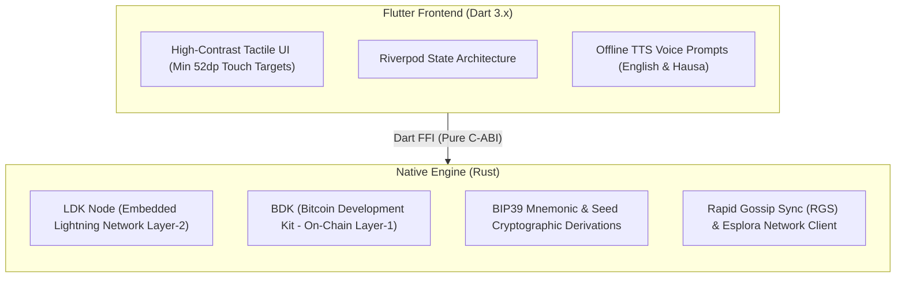

# Reliq

> **Self-Custodial Bitcoin & Lightning Mobile Platform for Informal Economies**

Reliq is a production-grade, self-custodial Bitcoin Lightning Network mobile wallet designed specifically for cash-heavy informal economies in emerging markets (Northern Nigeria and Sub-Saharan Africa). 

By uniting embedded **LDK Node (Layer-2 Lightning)**, **BDK (Layer-1 On-Chain)**, a high-contrast tactile UI with minimal text dependency, and 100% on-device offline voice synthesis (English & Hausa), Reliq enables daily micropayments and digital commerce without intermediaries or external custody.

---

## Architecture Overview

Reliq utilizes a hybrid architecture:



- **Frontend:** Flutter 3.x / Dart 3.x with Riverpod state management.
- **Native Core:** Rust crate (`native/`) exporting memory-safe C-ABI functions for LDK and BDK.
- **Hardware Security:** Android KeyStore (`EncryptedSharedPreferences`) on Android; dual-tier fallback on Linux desktop/WSL.
- **Voice Engine:** On-device Sherpa-ONNX TTS with lightweight Piper models for offline Hausa & English balance/payment announcements.

---

## Key Features

- **Strict Self-Custody:** All entropy, seed words, and private keys are derived on-device and stored in hardware-backed storage (Android KeyStore / fallback). Keys never touch external servers.
- **Tactile UI (Low Literacy First):** Four large, color-coded tactile action blocks (**RECEIVE**, **SEND**, **ACTIVITY**, **VOICE**) with high outdoor sunlight contrast.
- **Dual-Layer Bitcoin Support:**
  - **Lightning (BOLT11):** Instant micropayments with dynamic QR generation and quick satoshi chips (`+500`, `+1,000`, `+2,500`, `+5,000`, `+10,000`, `+50,000` sats).
  - **On-Chain (BDK):** Native SegWit (`bc1q` / `tb1q`) address generation and balance management.
- **LSP Dynamic Inbound Liquidity (Phase 3):** Automated channel provisioning via LSP (LSPS2) for seamless receiving even when zero local channel inbound liquidity exists.
- **Intermittent Connectivity & Background Push (Phase 3):** Silent push notifications (FCM) wake the app to automatically claim held HTLCs when returning to cellular coverage.
- **Offline Voice Layer (Phase 4):** On-device speech synthesis (Sherpa-ONNX / Piper) for wallet balance, payment sent, payment received, and invoice creation in both **English** and **Hausa** with marketplace number denominations.
- **Seed Verification Gate:** Enforces mandatory interactive 3-word verification before wallet activation.
- **Payment Safety:** Payment confirmation modal with real-time fee ceiling estimation and spendable balance validation.
- **Local Activity Log:** Encrypted on-device transaction history with relative timestamps and detailed status sheets.

---

## Project Structure

```text
reliq/
├── android/                 # Android native project configuration & NDK bindings
├── linux/                   # Linux desktop runner (WSLg & Linux support)
├── native/                  # Rust C-ABI engine
│   ├── Cargo.toml           # Rust dependencies (ldk-node, bdk, bip39, serde)
│   ├── src/lib.rs           # C-ABI export functions & unit tests
│   └── lib/                 # Compiled shared library (libreliq_native.so)
├── lib/
│   ├── background/          # Headless background service for silent push claims
│   ├── core/                # Themes, network constants, formatters
│   ├── data/
│   │   ├── ldk/             # Dart FFI bindings, LDK/BDK models, and LSP client
│   │   ├── push/            # Firebase Cloud Messaging & silent push wake-up
│   │   ├── storage/         # Secure storage service & payment history
│   │   └── tts/             # Offline TTS service & Hausa/English voice prompts
│   └── presentation/
│       ├── providers/       # Riverpod wallet state notifiers
│       └── screens/
│           ├── onboarding/  # Welcome, Seed Generation, 3-Word Verification, Restore
│           ├── home/        # 4-block tactile home screen & satoshi balance cards
│           ├── receive/     # BOLT11 Lightning QR & BDK On-Chain SegWit tabs
│           ├── send/        # Camera reticle scanner & payment confirmation modal
│           ├── activity/    # Chronological payment history & detail modal
│           └── settings/    # Language (English/Hausa), Voice toggle, Seed backup
├── test/                    # Unit, FFI integration, widget, and voice test suites
├── docs/                    # In-depth technical guides
│   ├── getting_started.md   # Complete step-by-step run & test manual
│   └── tts_piper_sherpa_guide.md # On-device speech synthesis & Hausa rules
└── README.md                # Project documentation
```

---

## Demo Walkthrough (Judges & Evaluators)

1. **First-Time Setup (Self-Custody & Backup):**
   - Launch app & tap **Create New Wallet**.
   - Review 12-word seed phrase generated purely on-device via Rust entropy.
   - Complete mandatory 3-word challenge to prove the seed was safely written down.
2. **Tactile Dashboard & Offline Voice Balance:**
   - Tap the central balance card or the **VOICE** action block.
   - App speaks: *"Your balance is 0 sats"* (or in Hausa: *"Kudin ka ya kai satoshi sifili"*).
3. **Receive Payment with Dynamic LSP Inbound Liquidity:**
   - Tap **RECEIVE**; choose preset chip `+2,500` or toggle LSP Inbound Liquidity.
   - Tap the QR code: app speaks *"Invoice created for 2,500 sats"* (or *"An kirkiro daftari na satoshi dubu biyu da dari biyar"*).
4. **Send Lightning Payment:**
   - Tap **SEND**, point camera or paste a `lnbc...`/`lntb...` invoice.
   - Review fee breakdown and satoshi destination on the confirmation sheet.
   - Confirm send: payment settles instantly over Lightning, and voice confirms *"Payment sent: X sats"*.
5. **Language & Voice Customization:**
   - Navigate to **Settings** (`⚙` icon), switch language between **English** and **Hausa**.
   - App confirms selection audibly in the chosen tongue.
6. **Recovery Proof:**
   - In Settings, tap **Wipe Wallet**, then restore on another device or simulator using the 12-word phrase to demonstrate full self-custodial key recovery.

---

## Quick Start: How to Run & Test

For detailed instructions and troubleshooting, see **[`docs/getting_started.md`](docs/getting_started.md)**.

### 1. Build the Native Rust Engine
```bash
cd native
CARGO_TARGET_DIR=/home/maheer-wsl/.cargo-target/reliq cargo build --release
mkdir -p lib && cp /home/maheer-wsl/.cargo-target/reliq/release/libreliq_native.so lib/
cd ..
```

### 2. Run the Application

- **On Desktop (WSLg / Linux):**
  ```bash
  flutter run -d linux
  ```
  *(Or execute the built bundle directly: `./build/linux/x64/debug/bundle/reliq`)*

- **On an Android Phone (USB Debugging enabled):**
  ```bash
  flutter run
  ```

### 3. Compile Standalone Builds

- **Build Android APK:**
  ```bash
  flutter build apk --debug
  ```
  *Output: `build/app/outputs/flutter-apk/app-debug.apk`*

- **Build Linux Desktop Bundle:**
  ```bash
  flutter build linux --debug
  ```
  *Output: `build/linux/x64/debug/bundle/reliq`*

### 4. Run Automated Test Suites

- **Flutter Tests (40/40 passing):**
  ```bash
  flutter test
  ```
- **Rust Native Engine Tests (6/6 passing):**
  ```bash
  cd native && CARGO_TARGET_DIR=/home/maheer-wsl/.cargo-target/reliq cargo test
  ```

---

## License

This project is licensed under the MIT License - see the LICENSE file for details.
