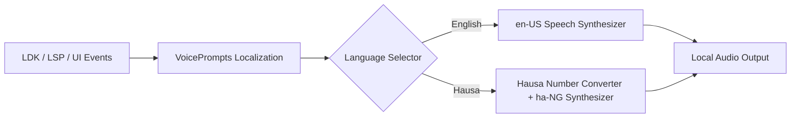

# Reliq Offline Voice Layer (Sherpa-ONNX & Piper Architecture)

## Overview

In informal markets across Northern Nigeria (e.g., Kurmi Market in Kano, Central Market in Kaduna), vendors and daily shoppers operate in loud, bustling outdoor environments where looking at small smartphone screens or reading complex financial strings is impractical or excluded by low textual literacy.

Reliq integrates an **Offline Voice Layer** designed to deliver instant, tactile, on-device audio feedback for financial operations in both **English** and **Hausa** without requiring internet connectivity or external cloud speech APIs.

---

## 1. Architecture



### Key Components

1. **`VoicePrompts` (`lib/data/tts/voice_prompts.dart`):**
   - Pure Dart localization engine generating natural spoken phrases for wallet balance, payment sent, payment received, invoice generation, and state changes.
   - Includes a culturally natural `numberToHausaWords(int n)` parser designed specifically for currency and marketplace satoshi denominations.

2. **`TtsService` (`lib/data/tts/tts_service.dart`):**
   - High-level service managing speech rate (tuned to 0.85 for market audibility), volume, pitch, and voice toggling (muted vs. active).
   - Coordinates with `flutter_tts` which interfaces with native Android `TextToSpeech` services or on-device Piper / Sherpa-ONNX engines.

3. **Inference Engines:**
   - **Sherpa-ONNX:** C++ / ONNX-Runtime based offline speech synthesis engine running natively on device CPU/NPU without cloud dependencies.
   - **Piper:** High-speed, local neural text-to-speech system based on VITS (Variational Inference for Text-to-Speech) providing natural human voices at small model sizes (15–30 MB per voice).

---

## 2. Hausa Language & Marketplace Denominations

Northern Nigerian commerce relies heavily on verbal confirmation. Numbers in Hausa follow precise grammatical conjunctions:

| Arabic Numeral | Hausa Spoken Form | Marketplace Context |
|---|---|---|
| `500` | *dari biyar* | Common tea / snack payment |
| `1,000` | *dubu daya* | Standard single item purchase |
| `1,500` | *dubu daya da dari biyar* | Small trade amount |
| `2,500` | *dubu biyu da dari biyar* | Market staple payment |
| `5,000` | *dubu biyar* | Medium grain / food purchase |
| `10,000` | *dubu goma* | Wholesale bag purchase |
| `12,450` | *dubu goma sha biyu da dari hudu da hamsin* | Exact balance example |
| `50,000` | *dubu hamsin* | Bulk transaction |
| `100,000` | *dubu dari daya* | Livestock trade |

### Conjunction Rules Implemented in `numberToHausaWords`:
- Tens and single units: joined with `da` (*ashirin da biyar* = 25).
- Hundreds and tens: joined with `da` (*dari biyu da hamsin* = 250).
- Thousands and remainder: joined with `da` (*dubu daya da dari biyar* = 1,500).
- Teens (11–19): structured with `goma sha` prefix (*goma sha biyu* = 12).

---

## 3. Supported Event Triggers

| Event | English Prompt | Hausa Prompt |
|---|---|---|
| **Balance Tap / Voice Check** | *"Your balance is 12,450 sats"* | *"Kudin ka ya kai satoshi dubu goma sha biyu da dari hudu da hamsin"* |
| **Payment Received (Instant / Background Push)** | *"Payment received: 5,000 sats"* | *"An karbi satoshi dubu biyar"* |
| **Payment Sent (Confirmed)** | *"Payment sent: 1,500 sats"* | *"An tura satoshi dubu daya da dari biyar"* |
| **Invoice Generated (QR Tap)** | *"Invoice created for 2,500 sats"* | *"An kirkiro daftari na satoshi dubu biyu da dari biyar"* |
| **Voice Feedback Toggled On** | *"Voice feedback activated"* | *"An kunna murya"* |
| **Voice Feedback Muted** | *"Voice feedback muted"* | *"An kashe murya"* |
| **Language Switched** | *"Language set to English"* | *"An canza harshe zuwa Hausa"* |

---

## 4. Package Visibility & Hardware Permissions

On Android 11+ (API level 30+), package visibility restrictions prevent applications from interacting with TextToSpeech engines unless declared in `<queries>`.

Reliq's `android/app/src/main/AndroidManifest.xml` includes:

```xml
<queries>
    <intent>
        <action android:name="android.intent.action.TTS_SERVICE" />
    </intent>
    <intent>
        <action android:name="android.intent.action.PROCESS_TEXT"/>
        <data android:mimeType="text/plain"/>
    </intent>
</queries>
```

This guarantees discovery of on-device Google TTS, Sherpa-ONNX, and Piper speech synthesis services.

